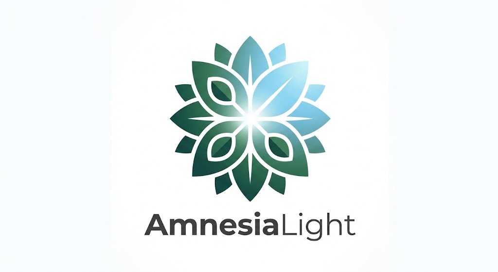
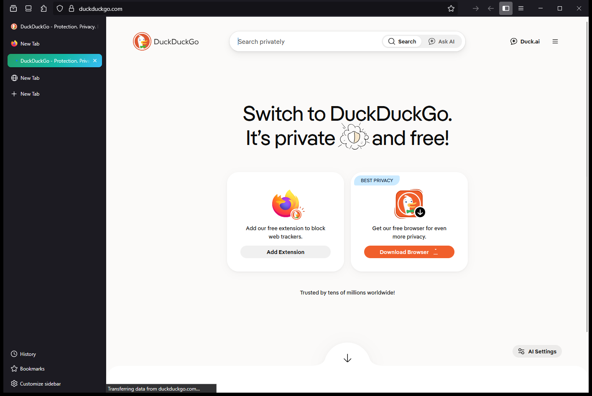

# AmnesiaLight

Navigateur **ultra-securise**, **leger** et **respectueux de la vie privee**.
Recherche **DuckDuckGo** par defaut, **navigation privee par defaut**, zero
telemetrie, zero publicite. Interface minimaliste arrondie (inspiration Arc /
macOS) aux couleurs **vert & bleu** d'AmnesiaLight.

---

## Points forts

- **DuckDuckGo par defaut** : aucun autre moteur, suggestions desactivees.
- **Prive par defaut** : le lanceur ouvre une fenetre privee (aucune trace).
- **Amnesia** : cache 100 % en memoire, pas de cookies persistants, script
  d'effacement immediat (`launch/wipe.*`).
- **Ultra-securise** : anti-empreinte (`resistFingerprinting`), protection
  anti-pistage stricte, **HTTPS obligatoire**, **DNS-over-HTTPS strict**
  (Quad9), WebRTC/DRM desactives, permissions refusees par defaut.
- **Leger** : telemetrie, Pocket, contenu sponsorise, extraits et etudes
  desactives ; dechargement des onglets inactifs.
- **Theming** : barre d'onglets **verticale** style Arc, accent degrade vert → cyan
  sur l'onglet actif, **disposition par defaut** (aucun arrondi force, aucune
  transparence qui casse la mise en page).

## Apercu



## Arborescence

```
AmnesiaLight/
├─ logo.png / banner.jpg     # identite visuelle (source)
├─ assets/                   # logo vectoriel + captures
├─ icons/                    # icones .ico/.png 16 -> 512 (fond transparent)
├─ profile/
│  ├─ user.js                # preferences durcies (appliquees a chaque demarrage)
│  ├─ search/duckduckgo.xml  # moteur DuckDuckGo AmnesiaLight
│  └─ chrome/
│     ├─ userChrome.css      # theme de l'interface
│     ├─ userContent.css     # pages internes
│     └─ icons/              # icones pour l'UI
├─ distribution/policies.json# moteur par defaut + verrouillage securite
├─ launch/                   # lanceurs Windows / Linux + effacement
├─ engine/                   # moteur de rendu (present ; non versionne)
│  └─ distribution/          # policies lues par le moteur
├─ build/                    # (Phase 2) outillage de compilation + rebrand
├─ tools/                    # generateur d'icones, packager portable
├─ website/                  # site statique de presentation (GitHub Pages)
├─ dist/                     # paquet portable genere (non versionne)
└─ docs/                     # INSTALL, SECURITY, CONTRIBUTING
```

## Demarrage rapide

Le moteur est deja provisionne dans `engine/` (voir `engine/VERSION.txt`).

1. Lance :
   - **Windows** : `launch\AmnesiaLight.cmd`
   - **Linux**   : `bash launch/amnesialight.sh`

La fenetre s'ouvre en **mode prive** avec DuckDuckGo.

### Paquet portable (Windows)

```
powershell -ExecutionPolicy Bypass -File tools\package-portable.ps1
```

Produit `dist\AmnesiaLight-<version>-portable-win64.zip` (moteur + profil +
policies + lanceurs), a lancer directement depuis une cle USB.

## Sessions optionnelles

Par defaut AmnesiaLight ne laisse aucune trace. Pour garder une session
(onglets, connexions) :

- Demarre avec l'option `--session` :
  - Windows : `launch\AmnesiaLight.cmd --session`
  - Linux   : `bash launch/amnesialight.sh --session`
- Les donnees restent dans `profile/` jusqu'a ce que tu lances un effacement.

## Effacer immediatement (mode Amnesia)

Ferme le navigateur puis lance :

- Windows : `launch\wipe.cmd`
- Linux   : `bash launch/wipe.sh`

## Configuration

- Preferences generales : `profile/user.js`
- Reglages verrouilles/entreprise : `distribution/policies.json`
  (copie lue par le moteur : `engine/distribution/policies.json`)
- Theme : `profile/chrome/userChrome.css` et `userContent.css`

## Site de presentation

Le dossier `website/` contient un site statique (sans dependance externe),
pileable sur GitHub Pages. Voir `website/README.md`.

**En ligne : <https://amnesialight.edgeone.dev/>** — cette URL est la
**page d'accueil par defaut** d'AmnesiaLight (`profile/user.js` +
`distribution/policies.json` → policy `Homepage`).

## Roadmap

- **Phase 1 (actuelle)** : distribution themee, durcie, portable — **operationnelle**.
- **Phase 2** : moteur compile et rebrande au nom d'AmnesiaLight via l'outillage
  `build/` + CI GitHub Actions (`.github/workflows/amnesialight-build.yml`),
  installeurs Windows et paquets Linux, publication sur GitHub.

## Licence

MPL-2.0 (voir `LICENSE`).

---

AmnesiaLight — [github.com/urbanyl](https://github.com/urbanyl)
